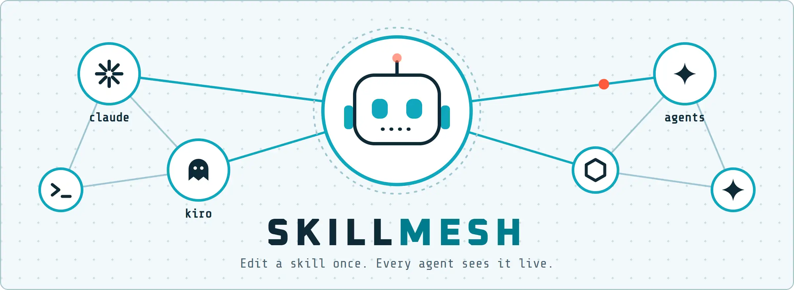
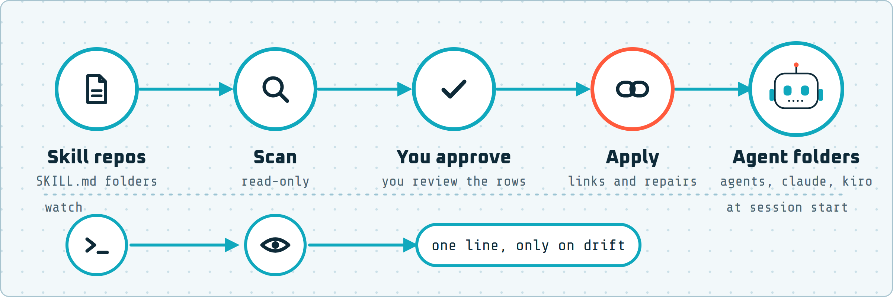
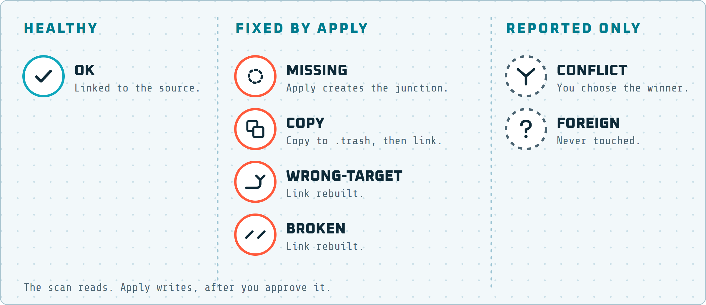
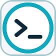
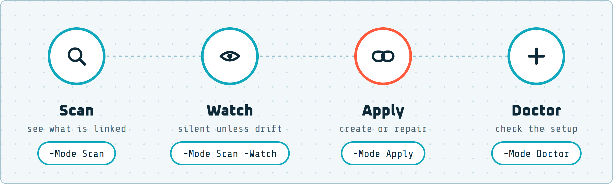
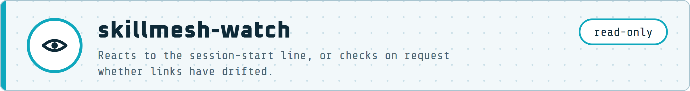
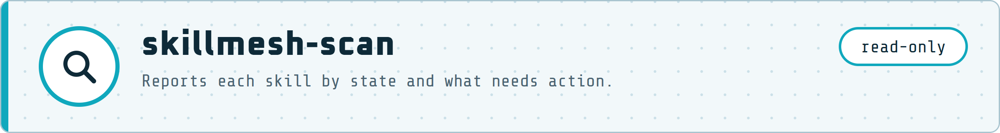
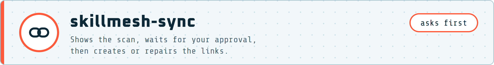
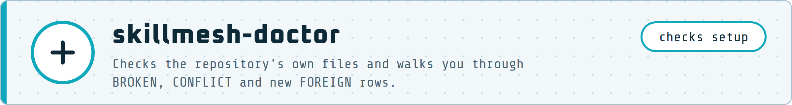

<h1 align="center">
<picture><source media="(prefers-color-scheme: dark)" srcset="assets/banner-dark.webp"></picture>
</h1>

<p align="center"><strong>Keep every skill in its own repo. Skillmesh puts it in front of every agent, and keeps it there.</strong></p>

<p align="center">
<a href="#why-skillmesh"><picture><source media="(prefers-color-scheme: dark)" srcset="assets/btn-why-dark.webp"></picture></a>
<a href="#how-it-works"><picture><source media="(prefers-color-scheme: dark)" srcset="assets/btn-how-dark.webp"></picture></a>
<a href="#quick-start"><picture><source media="(prefers-color-scheme: dark)" srcset="assets/btn-start-dark.webp"></picture></a>
<a href="#safety"><picture><source media="(prefers-color-scheme: dark)" srcset="assets/btn-safety-dark.webp"></picture></a>
<a href="#reference"><picture><source media="(prefers-color-scheme: dark)" srcset="assets/btn-ref-dark.webp"></picture></a>
</p>

## <picture><source media="(prefers-color-scheme: dark)" srcset="assets/ico-why-dark.webp"></picture> Why Skillmesh

Your agents read skills from their own folders. Your skills live in repos. Copying one into the other works until the first edit, and then every copy is a little out of date.

Skillmesh closes that gap. It scans the skill repos under the roots you choose and links each skill into every agent skill folder with an NTFS junction. A junction is a pointer, not a copy, so a change you make in a skill repo is already there when the agent reads it. No reinstall, no `npx skills update`, no drift.

- **One source of truth.** The repo is the skill. Agent folders only point at it.
- **Every agent, one pass.** Link the same skill into each configured target in a single run.
- **Nothing happens without a look.** A scan is read-only, and `Apply` runs only after you have seen the exact rows it will change.
- **Drift gets noticed.** A session-start check prints one line when something stops matching, and nothing when all is well.
- **No admin rights.** Junctions need no elevation, so a standard user account is enough.

## <picture><source media="(prefers-color-scheme: dark)" srcset="assets/ico-how-dark.webp"></picture> How it works

<picture><source media="(prefers-color-scheme: dark)" srcset="assets/flow-dark.webp"></picture>

1. **Scan.** Skillmesh walks your roots, finds every folder that holds a `SKILL.md`, and compares it with each agent folder. Nothing is changed.
2. **Approve.** You read the rows. Each skill is in one state, and the figure below says what `Apply` does with it.
3. **Apply.** Missing links are created, broken or misdirected links are rebuilt, and real copies are moved to a `.trash` folder and replaced by a link.
4. **Watch.** A read-only check can run at the start of a session. It stays silent until something drifts.

When two repos hold a skill with the same name, the one closest to a root wins. If both sit at the same depth, nothing is linked until you pick a winner in `overrides`.

## <picture><source media="(prefers-color-scheme: dark)" srcset="assets/ico-checks-dark.webp"></picture> What it checks

<picture><source media="(prefers-color-scheme: dark)" srcset="assets/states-dark.webp"></picture>

<details>
<summary>The same states as a table</summary>

| State | Meaning | What `Apply` does |
|---|---|---|
| `OK` | The target holds a junction to the winning source. | Nothing. |
| `MISSING` | A skill has no entry in the target. | Creates the junction. |
| `COPY` | The target holds a real folder, for example from an `npx skills` install. | Moves it to `<target>\.trash\<name>-<timestamp>`, then creates the junction. The scan reports how the copy differs from the source. |
| `WRONG-TARGET` | A junction points somewhere other than the winning source. | Removes the link only, then creates the right one. |
| `BROKEN` | A junction points at a path that no longer exists. | Removes the link only, then creates the junction. |
| `CONFLICT` | Two sources of the same name sit at the same depth. | Nothing. Pick a winner in `overrides`. |
| `FOREIGN` | A target entry has no source under your roots. | Nothing. It is reported, never touched. |

</details>

## <picture><source media="(prefers-color-scheme: dark)" srcset="assets/ico-start-dark.webp"></picture> Quick start

You need Windows, Git and [uv](https://docs.astral.sh/uv/). `uv` fetches Python 3.12 or newer on first run; the scripts use only the standard library. Run these from a terminal.

```powershell
git clone https://github.com/the-khiem7/skillmesh.git skillmesh
cd skillmesh
uv run scripts\skillmesh.py --mode init
```

`Init` copies `skillmesh.config.example.json` to `skillmesh.config.json`. That file stays on your machine and is ignored by git. Open it and set:

| Key | Set it to |
|---|---|
| `roots` | the folders that hold your skill repos |
| `targets` | the agent skill folders to link into (the example lists `agents`, `claude` and `kiro`) |
| `ignore` | repos to skip |
| `known_foreign` | target entries you know are not managed here |

Then check the config, look, and link:

```powershell
uv run scripts\skillmesh.py --mode doctor
uv run scripts\skillmesh.py --mode scan
uv run scripts\skillmesh.py --mode apply --target claude
```

`--target` takes `both` (agents and claude, the default), `all` (every target of the config) or any target name the config holds. Apply one target at a time if you want to check each result before the next.

## <picture><source media="(prefers-color-scheme: dark)" srcset="assets/ico-daily-dark.webp"></picture> Everyday use

<picture><source media="(prefers-color-scheme: dark)" srcset="assets/daily-dark.webp"></picture>

```powershell
uv run scripts\skillmesh.py --mode scan
uv run scripts\skillmesh.py --mode scan --watch
uv run scripts\skillmesh.py --mode apply --target <target>
uv run scripts\skillmesh.py --mode doctor
```

Narrow a scan with `--target <target>` or `--name <skill>`.
A scan also writes `state\last-scan.py.json`. It is generated, not committed, and the next scan replaces it.

### Control page

To work by clicking instead of typing, start the local page:

```powershell
uv run scripts\skillmesh_ui.py
```

It opens `http://127.0.0.1:8765/` in your browser (`--port <n>` changes the port, `--no-open` skips the browser). Scan, Doctor, Link and Init are buttons. To Apply, tick rows of the scan on screen and confirm; a row is refused if the filesystem changed since that scan. `FOREIGN` and `CONFLICT` rows are view only. The page listens on `127.0.0.1` only and every request needs a token that changes each time the server starts. Stop it with Ctrl+C.

## <picture><source media="(prefers-color-scheme: dark)" srcset="assets/ico-agent-dark.webp"></picture> Let your agent run it

Skillmesh ships four skills that wrap the script, so an agent can operate it for you.

<picture><source media="(prefers-color-scheme: dark)" srcset="assets/skill-watch-dark.webp"></picture>

<picture><source media="(prefers-color-scheme: dark)" srcset="assets/skill-scan-dark.webp"></picture>

<picture><source media="(prefers-color-scheme: dark)" srcset="assets/skill-sync-dark.webp"></picture>

<picture><source media="(prefers-color-scheme: dark)" srcset="assets/skill-doctor-dark.webp"></picture>

Link them into this repository's own agent folders with:

```powershell
uv run scripts\skillmesh.py --mode link
```

`--mode link` works before any config exists. Add `--agent claude` or `--agent kiro` to link one, then restart the agent session so it sees the skills. For Claude it also creates a `SessionStart` hook in `.claude\settings.json` when that file is absent. The hook runs the read-only watch scan.

## <picture><source media="(prefers-color-scheme: dark)" srcset="assets/ico-safety-dark.webp"></picture> Safety

- A scan never changes your links. `Apply` runs after you approve the output.
- A real folder in a target is moved to `<target>\.trash`, never deleted.
- A junction is removed as a link only. The skill behind it is never touched.
- `FOREIGN` entries are reported and left alone.
- Skillmesh does not edit your skill repos, and it does not commit anything.
- Do not run `npx skills update` or `npx skills add` for skills Skillmesh links: they replace junctions with copies.

## <picture><source media="(prefers-color-scheme: dark)" srcset="assets/ico-ref-dark.webp"></picture> Reference

<details>
<summary>Configuration keys</summary>

The committed template is `skillmesh.config.example.json`. `%USERPROFILE%` and other environment variables in `roots` and `targets` are expanded.

| Key | Meaning |
|---|---|
| `roots` | Folders searched for skills. A folder holding `SKILL.md` is one skill and is not searched further. Dot folders, `node_modules` and `ignore` paths are skipped. |
| `targets` | Name and path of each agent skill folder. |
| `precedence` | `shallowest-wins`: the source closest to a root wins a name clash. |
| `ignore` | Repos or paths that are never scanned. |
| `known_foreign` | Target entries shown as known instead of new. |
| `overrides` | Picks the winning source for a name that would otherwise be a `CONFLICT`. |
| `trash_dir` | Folder name inside each target that receives replaced copies. |

Every mode except `Link` and `Init` stops until the config exists.

</details>

<details>
<summary>Modes and switches</summary>

| Mode | Effect |
|---|---|
| `init` | Copies the example config to `skillmesh.config.json` when it is absent. |
| `scan` | Compares skills with targets. Read-only apart from `state\last-scan.py.json`. |
| `apply` | Creates and repairs links. Changes the filesystem. |
| `doctor` | Checks that roots, targets, `AGENTS.md` and `skills\` exist. Exits 1 when it prints an issue. |
| `link` | Links this repository's `skills\` into `.claude\skills` and `.kiro\skills`. |

Switches: `--mode init|scan|apply|doctor|link`, `--target both|all|<target name>`, `--name <skill>`, `--no-hash`, `--watch` (implies `--no-hash`, prints only when something other than `OK` or a known `FOREIGN` entry exists, and exits 0), `--agent claude kiro` for `link`.

</details>

<details>
<summary>Files</summary>

| Path | Role |
|---|---|
| `scripts\skillmesh.py` | The core: init, scan, apply, doctor, link. Standard library only, run with `uv run`. |
| `scripts\skillmesh_ui.py` | The local control page server. |
| `ui\index.html` | The control page. |
| `scripts\Skillmesh.ps1` | The earlier PowerShell core, kept until the Python core has had one verified cycle. |
| `skillmesh.config.example.json` | Committed template for the config. |
| `skillmesh.config.json` | Your config. Ignored by git. |
| `skills\` | The four project skills. |
| `docs\baseline\skillmesh\` | The documentation pack: scope, decisions with their reasons, phases and source layout. |
| `assets\` | README images. Their sources are in `assets\source\`. |
| `AGENTS.md` | Working guidance for agents that operate this repository. |

</details>
