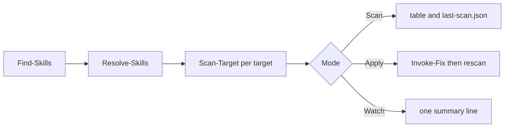

# Skillmesh - source topology

## Files

| Path | Role |
|---|---|
| `scripts\Skillmesh.ps1` | the earlier PowerShell core: init, scan, apply, doctor, link; kept until one verified cycle on the Python core and the user's approval to remove it |
| `scripts\skillmesh.py` | Python port of the core, run with `uv run`; stdlib only; same modes and switches (`--mode`, `--target`, `--name`, `--no-hash`, `--watch`, `--agent`); writes `state\last-scan.py.json`; links through `mklink /J` and removes only with `os.rmdir`; refuses a path with a `cmd` metacharacter; used by the hook and the four project skills |
| `scripts\skillmesh_ui.py` | control page server: stdlib `ThreadingHTTPServer` on `127.0.0.1`, imports `skillmesh.py`, one operation at a time under a lock; routes `POST /api/scan`, `/api/apply`, `/api/doctor`, `/api/link`, `/api/init`; `GET /` serves `ui\index.html` with the per-start token and a CSP nonce injected |
| `ui\index.html` | the control page: one static file, no CDN, no inline `style` attribute (nonce CSP), rows drawn with `textContent` only; tokens on `:root`, light and dark by `prefers-color-scheme`, rows stack as cards under 640px |
| `skillmesh.config.example.json` | committed template with neutral values and `%USERPROFILE%` |
| `skillmesh.config.json` | gitignored; roots, targets, precedence, ignore, known_foreign, overrides, trash_dir; created by `-Mode Init` |
| `skills\skillmesh-*` | four project skills wrapping the script; the only real copy |
| `.claude\`, `.kiro\`, `.agents\` | gitignored; `-Mode Link` junctions `skills\<name>` into `.<agent>\skills\<name>` |
| `.claude\settings.json` | gitignored; `SessionStart` hook running `uv run scripts\skillmesh.py --mode scan --watch --target all`, created by `--mode link` when absent |
| `state\last-scan.json` | generated by every scan; not committed |

## Flow

## Functions in `Skillmesh.ps1`

| Function | Does |
|---|---|
| `Find-Skills` | walks each root; a directory holding `SKILL.md` is one skill and is not descended; skips dot folders, `node_modules`, reparse points and `ignore` paths |
| `Resolve-Skills` | one winner per name: override first, else shallowest, equal depth is a CONFLICT |
| `Scan-Target` | per skill: MISSING, OK, BROKEN, WRONG-TARGET or COPY; then CONFLICT rows; then FOREIGN rows |
| `Compare-Trees` | for a COPY, counts files only in source, only in copy and changed, ignoring `.git` |
| `Invoke-Fix` | COPY moves to `<target>\.trash\<name>-<timestamp>`; WRONG-TARGET and BROKEN remove the link only; then creates the junction |
| Config load | expands environment variables in `roots` and `targets`; a missing config stops every mode except `Link` and `Init` |
| `Invoke-Link` | for each `-Agent`, junctions every `skills\<name>` into `.<agent>\skills\`; relinks a wrong junction, skips a real directory; creates the Claude hook when absent |
| `Test-Doctor` | checks that roots, targets, `AGENTS.md` and `skills\` exist |

## Modes and switches

- `-Mode Scan` is read-only apart from writing `state\last-scan.json`; `-Mode Apply` changes the filesystem; `-Mode Doctor` checks the repository's own files; `-Mode Init` copies the example config when absent; `-Mode Link` with `-Agent claude|kiro` (default both) links `skills\` into the repo's agent folders.
- `-Target agents|claude|kiro|both|all`, `-Name`, `-NoHash`; `-Watch` implies `-NoHash`, prints only when something other than OK or a known FOREIGN entry exists, and exits 0.
- `Doctor` exits 1 when it prints an issue.
